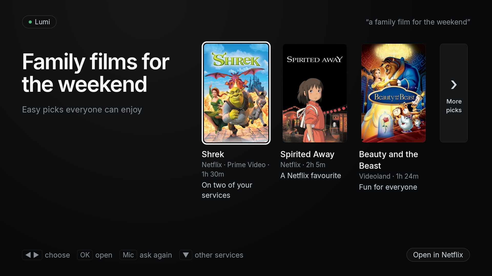

# Lumi TV

Lumi is a family "what should we watch?" assistant. Ask in plain words, in Claude Desktop or into the TV remote,
and the TV shows a few picks with posters, checked against the streaming services you have, with a kids-safe mode
that is enforced in code. Press OK and the title opens in its app. A Python server on your home network does the
work (MCP tools, TMDB, your viewing history); an Android TV app shows the answers. Tested on a TCL Google TV
(Android 14).



This product uses the TMDB API but is not endorsed or certified by TMDB.

## What you need

- An Android TV or Google TV device on Android 11 or newer with developer options on, so you can sideload the app
  over adb and configure it the same way. Tested on a TCL Google TV (Android 14); other devices are untested.
- A machine on the same LAN that stays on, for the server: [uv](https://docs.astral.sh/uv/) (it installs Python
  3.12 itself). Windows is the deployment that is written up (`server/deploy/windows.md`); macOS and Linux run the
  same commands, without the service setup.
- A TMDB account and its read-access token (themoviedb.org, Settings, API).
- A contact for Wikidata: an email address or a web page of yours, in the config (no sign-up). Without it Wikidata
  refuses lookups and Netflix picks open the app's home screen instead of the title.
- To ask from a computer: Claude Desktop, and Node.js so `npx` can run `mcp-remote`.
- To ask from the TV: Claude Code on the server machine, logged in with a Claude subscription (no API key).
- To build the TV app: JDK 17 and the Android SDK (platform 34).

## Try it in 5 minutes without a TV

```sh
cd server
cp lumitv.example.toml lumitv.toml   # then set [open] user_agent_contact and your [[services]] (see Configure)
cp .env.example .env                 # then put your TMDB token and a long random SERVER_TOKEN in it
uv run python scripts/e2e_check.py   # installs everything the first time, then plays six turns against real TMDB
```

`e2e_check.py` starts a throwaway server and a fake TV and plays the whole Desktop flow without Claude: find titles,
show them, open one, kids mode for a three-year-old, an answer while a video plays, the TV gone. It prints each
turn's picks and a timing table. Then run the real thing:

```sh
uv run lumitv serve                                             # terminal 1
uv run python scripts/fake_tv.py --screen-on --not-playing      # terminal 2: a fake TV that prints every message
```

and ask from [Claude Desktop](#claude-desktop) ("something funny for tonight"): the fake TV prints the `show`.
With Claude Code installed, `scripts/fake_tv.py --ask "something funny"` asks the way the TV does.

## Architecture

```
Claude Desktop --(mcp-remote: stdio to HTTP)--> +-----------------------------+ --> TMDB      titles, posters, providers, certificates
                                                |  Lumi server (Python, LAN)  | --> Wikidata  Netflix and Google ids for exact titles
TV app --(WebSocket /tv: state, answers)------> |  MCP tools, catalogue cache, | --> Claude Code (claude -p) for asks from the TV,
TV app --(POST /ask, /ask/audio)--------------> |  household DB, event log    |     which calls the same MCP tools back
                                                +-----------------------------+
```

Claude, in Desktop or in Code, sees only what the five [MCP tools](#mcp-tools) return. The server filters by
certificate before Claude sees a title, builds the launch intents from the config, re-checks every pick when it is
shown or opened, and talks to the TV over one WebSocket (wire format: [protocol.md](protocol.md)). Nothing ever
starts playing by itself.

## Run the server

```sh
cd server
cp lumitv.example.toml lumitv.toml        # once; the real file is gitignored
# then in lumitv.toml set [open] user_agent_contact to your email or URL (see below) and your services
cp .env.example .env                      # once; secrets only, gitignored: edit it, never paste tokens into a shell
uv run lumitv serve
curl localhost:8765/health                # -> ok
uv run lumitv doctor                      # checks the running server against the performance budgets
```

Get a TMDB read-access token at themoviedb.org (each user brings their own). Make `SERVER_TOKEN` a long random
string, for example `python3 -c 'import secrets; print(secrets.token_urlsafe(32))'`.

First-time setup also needs a contact for Wikidata: `[open] user_agent_contact` in `lumitv.toml`, an email address
or a web page of yours (no sign-up). Lumi looks up Netflix's and Google's title ids there; Wikidata refuses clients
that name no contact (HTTP 403, its robot policy), and then Netflix picks open Netflix's home screen instead of the
title. It stays in your `lumitv.toml` only; `lumitv doctor` fails and the server logs `setup_incomplete` while it is
empty.

The server warms its catalogue cache at start and daily at `[cache] warm_at`: on an empty cache that is a few
thousand TMDB requests over a couple of minutes, in the background; later starts reuse the cache. After each warm it
backs up the household tables (`backups/` next to the database, the newest 14 kept) and prunes cache rows older
than 45 days or past 300,000. The event log (`[server] log_path`) rotates daily and keeps 30 files.

Running it as a service: Windows, with a scheduled task and a watchdog, is in
[server/deploy/windows.md](server/deploy/windows.md). On Linux or macOS run `uv run lumitv serve` from the `server`
folder under systemd or launchd the same way; nothing else is needed.

## Configure

Everything personal or regional lives in `server/lumitv.toml`. The commented example, `server/lumitv.example.toml`,
is an example household (two catalogue regions, one service behind a VPN, daytime kids hours), not a neutral
default: start by replacing its `[[services]]` and `[ratings]` with yours. The server refuses a config with an
unknown key or a bad value and names it.

### Services

One `[[services]]` table per app you have:

- `id`, `label` (shown on the TV), `region` (the country whose catalogue TMDB checks: `uv run python
  scripts/list_providers.py US` prints TMDB's provider ids for a region; the example's regions are its default),
  `tmdb_provider_ids`, `package` (the Android app: `adb shell pm list packages | grep -i netflix`), and `vpn`:
  `"on"`, `"off"` or `"any"`, the VPN state the service works with.
- VPN state warns, never blocks: a title always opens. If the TV's VPN state is wrong for the service, the TV shows a
  short warning naming the VPN (`[assistant] vpn_name`, default "the VPN") and `open_title` returns a `vpn_warning`
  for Claude to mention.
- `launch` (optional) says how a pick opens in that app: an Android intent `action` plus `data` and/or `extras`
  (and optionally `component`, "package/.Activity"), with placeholders `{title}`, `{title_url}` (URL-encoded),
  `{tmdb_id}`, `{year}`, `{netflix_id}`. Example:
  `launch = { action = "android.intent.action.VIEW", data = "https://app.primevideo.com/search?phrase={title_url}" }`
  or `launch = { action = "android.intent.action.SEARCH", extras = { query = "{title}" } }`. Without `launch` the
  app just opens. Nothing ever auto-plays. The example's formats were tested on a TCL Google TV (Android 14); its
  comments say what each one reaches. See [Opening titles](#opening-titles).
- `search_hint = true`: the launch lands on the app's search screen but can't type the title, so after opening the
  TV shows `Search for "<title>"` for a few seconds (it never takes the remote's focus).
- `google_tv = true` and `relaunch_after_s`: see [Opening titles](#opening-titles).

Launch formats, services and regions are config: a wrong deep link or a new service is fixed by editing the toml
and restarting the server. From 1.0.0 the TV app sees every TV app by intent, so adding a service needs no app
rebuild.

### Kids mode

Kids mode filters every candidate by age certificate before Claude sees it, and the server re-checks each pick when
it is shown or opened; a pick from a search with other kids settings is refused. It is on:

- by default between `[kids] default_from` and `default_until` (the example: 06:00–19:00 local time), unless the
  question says it is for grown-ups ("for us", "after the kids are in bed"). Remove both keys for "only when asked".
- whenever an age is given ("for my 3-year-old": `kids_age`), or a child is among the viewers the TV named (the
  youngest's age sets the limit, and nothing Claude passes lifts it). When the TV names who is watching, that list
  decides instead of the clock: only grown-ups means grown-up picks even by day.

Certificates: `[ratings] country` is the home scheme (the example: the Dutch Kijkwijzer labels), `fallback_country`
with `fallback_map` translates another country's labels into it. `[kids] ages` maps every label to a minimum age
(default `AL = 0, "6" = 6, "9" = 9, "12" = 12, "14" = 14, "16" = 16, "18" = 18`); every label in `order`,
`toddler_allowed`, `no_age_max` and in `fallback_map`'s values must be in it, or the server refuses to start and
names the label. A title's certificate is the strictest one among the home country's TMDB entries, cross-checked
against the fallback country's mapped certificate (the stricter wins); a label not in `ages` never makes a title
eligible, and unrated titles are never shown in kids mode. `[kids] max_age` (15) caps the age an ask can set:
"for my 17-year-old" is treated as 15, so 16+ and 18+ titles never appear in kids mode. Below `toddler_below_age` (6)
only the `toddler_allowed` labels pass; a child without an age gets at most `no_age_max`.

### Who's watching

The TV asks who watches it: names, and an age for each child ("Emma 6"). Pick who is watching now from the
"Watching" pill on Lumi's home screen; a choice holds for 4 hours, then the default for the time of day returns (inside the kids hours
everyone, outside them the grown-ups). A child among the viewers sets the kids limit on the server, whatever the
question says. Someone added without an age counts as a grown-up, and the TV says so next to the name: give
children their age. Names live only in the server's household tables (backed up with them), never in the repo; the
log counts viewers, it never names them.

### The rest

- `[assistant] name` is what the TV and Claude call the assistant; `vpn_name` is the VPN's name in the TV's
  warnings. The TV's strings come from the server (`content/strings.<code>.json`, placeholders `{assistant}` and
  `{vpn}` filled from these two).
- `[answers] picks` is how many titles an answer shows: 1 to 3.
- `[language] code` selects `content/strings.<code>.json` (the TV's copy) and `genre_aliases.<code>.json` /
  `genre_keywords.<code>.json` (genre names). It does not translate Claude's instructions (`content/instructions.md`),
  the prompt framing, the on-screen keyboard or the speech recognizer, and `[speech] language`/`model` are separate
  settings. Lumi is English-only in 1.0.0; the strings file is the hook for later.
- `[ask]` and `[speech]`: [Ask from the TV](#ask-from-the-tv). `[budgets]`: what `lumitv doctor` judges.
- `server/.env`: secrets only (`TMDB_TOKEN`, `SERVER_TOKEN`, optional `CLAUDE_CODE_OAUTH_TOKEN`). Process
  environment variables override it.
- `server/content/`: `instructions.md` (what Claude is told), `instructions_tv.md` (added for asks from the TV),
  `theme.json` (design tokens sent to the TV), `strings.<code>.json`, `genre_aliases.<code>.json`,
  `genre_keywords.<code>.json`.

The example config listens on `0.0.0.0` (`[server] host`) so a TV on the same network can reach it. It is meant
for a trusted LAN only: do not expose it to the internet. Every request except `GET /health` needs the bearer token
([Security](#security)).

## Your viewing history (optional, recommended)

Lumi tailors picks and skips titles you've already seen. Netflix has no API, but you can download your history:

1. On a computer, go to netflix.com → Account → Profiles → choose a profile → **Viewing activity** →
   **Download all** (bottom of the page). You get `NetflixViewingHistory.csv` (`Title,Date`). Repeat per profile you
   want counted; all profiles merge into one family profile.
2. Copy the file to the server machine and import it from the `server` folder:
   ```sh
   uv run lumitv import-netflix /path/to/NetflixViewingHistory.csv
   ```
   It prints `Added N rows`. Re-running the same file adds nothing (duplicates are skipped), so importing a newer
   download later is safe.
3. Delete the copied CSV afterwards if you like; the history lives only in the server's database (`db_path` in
   `lumitv.toml`). Claude only sees what the tools return, such as whether a suggested title was already watched.

Other services have no export; Lumi also learns from what you open and from "we loved that / not for us" said to Claude.

## Opening titles

When the family picks a title, the TV tries these in order and stops at the first that opens:

1. **Google TV's title page** (services with `google_tv = true`): the title, its rating and seasons, and a button
   that opens the app right at that title. Lumi needs the title's Google id for it; it looks that up once per title
   (TMDB, then Wikidata) and caches it. Google TV lists the apps of the country its own account is set to, which
   can differ from the catalogue region you configured (then a service of your region may have no button on that
   page). So turn it on only for services that page offers: the example has it on for Prime Video only. Tip: in
   Google TV's settings, add your apps under **Your services**, so the page's button says Watch instead of Subscribe.
2. **The app's own link** (`launch` in the toml):
   - Netflix: its title page (`netflix.com/title/<id>`, the id from Wikidata). Titles without a known Netflix id
     just open Netflix. If Netflix wasn't used in the last hour it is probably starting cold: it asks "who's
     watching" first and drops the link. Then the TV sends the link once more after 10 s (`relaunch_after_s`)
     and shows "Pick your profile — Lumi will open …". It re-sends once at most, and not if you left Netflix or
     Lumi came back. Playback state is not checked: on a cold start Netflix reports PLAYING on its profile picker
     and home-screen preview, so that signal would block the re-send that is needed. Without usage access (see
     [TV app setup](#tv-app-setup)) it never re-sends; it shows "Pick your profile, then press OK in Lumi again"
     and keeps the answer on Lumi's screen.
   - Wikidata needs a contact in the User-Agent (`[open] user_agent_contact`, a first-time setup step above); it is
     sent as `lumi-tv/<version> (<contact>) python-httpx/<version>`, where `<version>` is the server package's
     (1.0.0). Ids found are cached `wikidata_ttl_days` (30), titles without ids `wikidata_miss_ttl_days` (7).
   - Prime Video: its search screen; the TV shows the title to type.
   - Videoland: its (empty) search screen; the TV shows the title to type.
3. **The app itself**, if nothing above worked.

Nothing ever starts playing. If a lookup is slow (`[open] title_id_wait_s`, 0.25 s), the answer goes out without the
steps that need it (the lookup finishes in the background, so the next time is instant); the daily cache warm-up
looks them up ahead of time.

## TV app setup

One pass over adb, in this order (the overlay grant must come before CONFIGURE, or the app cannot start its link
service from the background). `P=io.github.miladaslaner.lumitv` throughout; run the commands from the `lumi-tv`
folder.

1. **Build the app:** `cd tv && ./gradlew assembleRelease` (JDK 17; the Android SDK at `sdk.dir` in
   `tv/local.properties` or `ANDROID_HOME`). The release build is not debuggable and is shrunk by R8; it is signed
   with your release key when one is configured, else with this machine's debug key, see
   [Release signing](#release-signing). It worked when `tv/app/build/outputs/apk/release/app-release.apk` exists.
2. **Connect adb:** on the TV, Settings → System → About, select the build number seven times, then Developer
   options → USB debugging (and Network debugging where offered). `adb connect <TV_IP>:5555`. It worked when
   `adb devices` lists the TV as `device`.
3. **Install:** `adb install -r tv/app/build/outputs/apk/release/app-release.apk`. It worked when adb prints
   `Success` and Lumi appears among the TV's apps.
4. **Let it draw over other apps and start itself** (Android 14: a foreground service and answers from the
   background need this):
   ```sh
   adb shell appops set $P SYSTEM_ALERT_WINDOW allow
   adb shell appops set $P AUTO_START allow   # TCL blocks apps from starting themselves; vendor-specific, harmless elsewhere
   ```
   It worked when `adb shell appops get $P SYSTEM_ALERT_WINDOW` prints `allow`. On other brands the second command
   may say the operation is unknown; that is fine.
5. **Playback state**, so an answer while a video plays becomes a small notice instead of covering it. Notification
   content is never read or logged.
   ```sh
   adb shell cmd notification allow_listener $P/$P.PlaybackWatcher
   ```
   It worked when `adb shell settings get secure enabled_notification_listeners` includes `PlaybackWatcher`, and,
   once the TV is connected (step 7), `uv run lumitv doctor` no longer says "playback state unknown". After a
   reinstall (`adb install -r`) the grant can stay in place while the listener is not bound: toggle it with
   `cmd notification disallow_listener $P/$P.PlaybackWatcher` then `allow_listener` again. Without this grant every
   answer arrives as the "Answer ready · press OK" notice and "Looking…" is never shown.
6. **Usage access**, so a Netflix link can be re-sent after its profile picker and the re-send stops when you leave
   the app. Nothing is logged or sent.
   ```sh
   adb shell appops set $P GET_USAGE_STATS allow      # revert: ... GET_USAGE_STATS default
   ```
   It worked when `adb shell appops get $P GET_USAGE_STATS` prints `allow`. Without it the link is never re-sent;
   the TV asks you to press OK in Lumi again.
7. **Tell the app where the server is** (once; nothing is baked into the APK). The token is read from `server/.env`,
   so it is never typed into a shell line:
   ```sh
   adb shell am broadcast -n $P/.ConfigReceiver -a $P.CONFIGURE \
       --es url ws://<SERVER_IP>:8765/tv --es token "$(grep ^SERVER_TOKEN= server/.env | cut -d= -f2-)"
   ```
   Name the receiver with `-n`: Android drops implicit broadcasts to manifest receivers, and `result=0` does not
   mean it was delivered. It worked when `adb logcat -s LumiTV` shows `configured` and then `connected`, and
   `uv run lumitv doctor` on the server prints `PASS  TV connected`.
8. **Microphone**, for spoken questions (without it a mic press opens the on-screen keyboard):
   ```sh
   adb shell pm grant $P android.permission.RECORD_AUDIO     # revert: pm revoke
   ```
   It worked when `adb shell dumpsys package $P | grep RECORD_AUDIO` shows `granted=true`.
9. **The remote's mic button** (optional: without it, open Lumi and press OK to ask). Lumi must hold the assistant
   role:
   ```sh
   adb shell settings get secure voice_recognition_service      # note the value first
   adb shell cmd role add-role-holder android.app.role.ASSISTANT $P
   # revert: adb shell cmd role remove-role-holder android.app.role.ASSISTANT $P
   ```
   It worked when a press of the remote's mic button opens Lumi, and `settings get secure
   voice_recognition_service` now names `$P` (the side effect below). Where the TV's own assistant app (Google
   Assistant) is still enabled it may take the mic button instead; disable it only if you are happy to lose it.

   **Known trade-off.** Holding the assistant role makes Android point `voice_recognition_service` at a stub inside
   Lumi that always refuses, so other apps' in-app voice search (YouTube's, for example) can fail while Lumi is the
   assistant. Lumi itself is not affected. To restore, run the role revert above, then
   `adb shell settings put secure voice_recognition_service <the value you noted>` (or `settings delete secure
   voice_recognition_service` if it was `null`).
10. **Open Lumi from the launcher.** The dot next to the name is green while the link is up and the idle line says
    what to do. If it is not green, `adb logcat -s LumiTV` says why: `not configured`, `server rejected token
    (4401)`, or a connection error (wrong address, server down, firewall).

Only adb can send the CONFIGURE broadcast (the receiver requires the DUMP permission). The link is plain `ws://` on
your LAN, so the app allows cleartext traffic. CONFIGURE also takes the voice settings below, on their own or with
`url`/`token`.

## Asking with your voice

A mic press records only after the press, only while Lumi's screen is in front, and stops by itself. There are two
ways to turn speech into a question; by default the server decides. When it has speech-to-text (`[speech] engine =
"faster-whisper"` with the `speech` extra installed and the model loaded) it says so when the TV connects, and the TV
uses `remote_mic`, so audio goes only to your server; otherwise (`engine = "none"`, the default) the TV uses
`recognizer`. To pin a route, send CONFIGURE with `--es voice recognizer|remote_mic|off`; `--es voice auto` goes
back to letting the server decide.

- `recognizer`: the TV's speech recognizer, bound by name (`--es recognizer <package>/<class>`, default
  `com.google.android.tts/com.google.android.apps.speech.tts.googletts.service.GoogleTTSRecognitionService`),
  on-device when it can (`--ez recognizer_offline false` to stop asking for that). Only the recognized text goes to
  the server.
- `remote_mic`: Lumi records the remote's mic itself (16 kHz mono) and sends the clip to your server's
  speech-to-text (`POST /ask/audio`, needs `[speech]` on the server). Tuning: `--ei mic_threshold <rms>` (speech
  threshold, at least 300), `--ei mic_source <MediaRecorder.AudioSource>`, `--ei mic_device_type <AudioDeviceInfo
  type>`.
- `off`: no voice; every press types.

**Privacy.** The microphone records only after a press, only while Lumi's screen is in front, and stops by itself at
`[speech] max_audio_s` (15 s by default; the TV learns the limit from the server). With `remote_mic` the clip goes
only to your server, is held in memory, never written to disk or logged, and is dropped once transcribed. With the
TV's recognizer, speech goes to that recognizer's provider (Google's speech services on a Google TV); Lumi itself
stores no audio.

## Ask from the TV

Press the remote's mic button (or open Lumi and type with the D-pad keyboard) and Lumi answers on the same answer
screen as a question asked in Claude Desktop. The server runs the Claude Code CLI (`claude -p`) with only Lumi's own
tools; a conversation continues across asks ("something lighter", "not that one") until `new_conversation_after_s`
of quiet.

Needs:
- **Claude Code, logged in with your Claude subscription, on the server machine** (no API key). Setup on a Windows
  PC: [server/deploy/windows.md](server/deploy/windows.md#claude-code-for-asks-from-the-tv); elsewhere install it as
  Anthropic's docs describe, run `claude` once to log in as the user the server runs as, and check `claude -p "Reply
  ok"`. For an account without an interactive login, `claude setup-token` gives a token for `CLAUDE_CODE_OAUTH_TOKEN`
  in `.env`.
- **Speech**, one of: speech-to-text on your server (`engine = "faster-whisper"`, the `speech` extra:
  `uv sync --extra speech`, and every later `uv sync` needs it too), which the TV then uses by default; or the TV's
  own recognizer. Without either, a mic press opens the keyboard.

Settings in `server/lumitv.toml` (these two sections are optional: the defaults are in `lumitv.example.toml`, and
you only write what differs):
- `[ask]`: `enabled` (false: the TV's asks get 503, Claude Desktop is unaffected), `claude_path` (`claude`), `model`
  (`claude-haiku-5-5`), `effort` (`low`), `new_conversation_after_s` (600, at least 60), `timeout_s` (45),
  `max_question_chars` (200, at most 1000; longer questions are refused, transcripts cut), `per_minute` (6) and
  `per_day` (150; HTTP 429 past either), `workdir` (`claude-home`), `mcp_url` (default: this server's `/mcp`).
- `[speech]`: `engine` (`none` or `faster-whisper`), `model` (`base.en`), `device`, `compute_type`, `cpu_threads`,
  `beam_size`, `language`, `max_audio_s` (15), `timeout_s` (10), `download_dir` (`models`), `ignore_phrases`
  (Whisper's usual words on silence, treated as nothing heard). Pick the model with `scripts/bench_stt.py` on your
  machine.

The TV reads the limits it needs from the server when it connects (`hello.limits`): its ask deadlines
(`timeout_s` plus a margin), the keyboard's length cap (`max_question_chars`) and the mic's cap (`max_audio_s`). So
changing these needs no app rebuild; an app from before 1.0.0 uses 55 s / 65 s, 200 characters and 15 s.

Upgrading from a server without asks: `[ask] enabled` defaults to true. If this machine has no Claude Code, set
`enabled = false`, otherwise `lumitv doctor` fails ("Claude Code … not found") and every start warns that it can't
pre-warm Claude.

When Claude Code can't answer, the TV shows a short line the family can act on, and the server's log and
`uv run lumitv doctor` say what to fix: logged out (run `claude` and `/login` as the server's user, or set
`CLAUDE_CODE_OAUTH_TOKEN`), the usage limit reached (asks work again once it resets), or no Claude Code at
`claude_path`. `doctor` fails while the last ask (under 6 h ago) ended in one of these; a successful ask clears it.

Playback: a mic press while a video plays pauses it. BACK returns to the video and plays it again; HOME, another app,
the screensaver or the screen turning off end the ask and leave the video paused; opening a pick leaves it paused
too.

What is logged: one `ask` line per ask in the server log with its id, source, transcript, outcome and stage times,
the same way typed questions are, plus the timings in `/stats`. Audio is never stored or logged. The TV's logcat has
ask ids and timings, never text. Claude Code also keeps its own session history on the server machine (under
`~/.claude`).

**Where the time went.** Each ask writes an `ask` line (server stages, Anthropic's own API time `claude_api_ms`,
model round trips `claude_turns`, and for spoken questions `upload_ms`, `audio_s`, `stt_ms`) and the TV adds
`ask_timing` (press → listening, end of speech → "Looking", → posters). A `loop_stall` line (with the code it was
stuck in) appears whenever the server stops responding for more than 0.25 s. One table per test session, with
medians and the `[budgets]` targets: `uv run python scripts/asks_report.py --since 2026-11-04T11:00` (in the server
folder; `--last N`, `--log PATH`, `--config PATH`, `--picks` for what each answer showed and why).

## Try it without a TV

```sh
cd server
uv run python scripts/fake_tv.py --screen-on --not-playing      # prints every message, acks `shown`
uv run python scripts/fake_tv.py --screen-on --playing          # acks with a "notice"
uv run python scripts/fake_tv.py --screen-off                   # server answers tv_off
uv run python scripts/fake_tv.py --playing-unknown              # like a TV without the listener grant
uv run python scripts/fake_tv.py --ask "something funny"        # asks like the TV's keyboard (needs Claude Code)
```

Flags: `--screen-on/--screen-off`, `--playing/--not-playing`, `--playing-unknown`, `--vpn/--no-vpn`, and with
`--ask` also `--answer-id` and `--focused-token` (a follow-up about an answer on screen); every message is printed
with the milliseconds since the ask. URL and token come from `--url`/`--token` or `LUMITV_URL`/`SERVER_TOKEN`
(falling back to `.env`); the token is never printed.

`scripts/e2e_check.py` starts a server of its own on a free port, with your `lumitv.toml` but a copy of your database
(so the cache is warm and what the run writes stays out of yours), a temporary log, asks off and no speech-to-text,
plus a fake TV, and plays a scripted conversation through the MCP client (binge, follow-up, open, kids mode, playing,
TV offline) against real TMDB. It prints each turn's picks and a timing table. A server you already run is not
touched. It does not cover asks from the TV (they need Claude Code).

```sh
uv run python scripts/e2e_check.py                  # the clients use this machine's LAN address
uv run python scripts/e2e_check.py --host 192.0.2.10   # when the detected address is wrong (a VPN is up, several interfaces)
uv run python scripts/e2e_check.py --via-loopback   # LAN Host header over loopback if a firewall blocks the LAN path
```

## Claude Desktop

Claude Desktop cannot add a plain-HTTP LAN server with a bearer token as a connector directly, so it reaches Lumi
through `mcp-remote`, a small bridge that Claude Desktop starts over stdio. Add this under `mcpServers` in
`claude_desktop_config.json` and restart Claude Desktop:

```json
"tv": {
  "command": "npx",
  "args": ["-y", "mcp-remote", "http://<HOST>:8765/mcp", "--allow-http",
           "--header", "Authorization: Bearer <SERVER_TOKEN>"]
}
```

`<HOST>` is the machine running the server (`localhost` if it is the same computer), `<SERVER_TOKEN>` the value
from `.env`. To keep the token out of the process list, put the line `Authorization: Bearer <SERVER_TOKEN>` in a file
only you can read and pass `"--header-file", "/path/to/lumi-headers.txt"` instead of `--header`.

For best results paste `server/content/instructions.md` into a Claude Project's instructions and use that Project for
TV chats. Replace its placeholders with your config: `{assistant_name}` (`[assistant] name`), `{services}` (your
services' labels, comma-separated), `{picks}` (`[answers] picks`), `{headline_max}` (70) and `{vpn_notes}` (one
sentence per service with `vpn = "on"` or `"off"`, such as "Videoland needs the TV's VPN on to work", or nothing).

macOS note: if other devices cannot reach the server but `localhost` works, the application firewall may be
blocking the Python binary (System Settings > Network > Firewall > Options, allow incoming connections for it).

## MCP tools

What Claude gets, in Desktop and in Code. Every answer turn is `find_titles` then `show_on_tv`.

| Tool | What it does | Key parameters |
|---|---|---|
| `find_titles` | Candidates on your services plus the family's taste; the TV shows "Looking for…" meanwhile. Kids mode as described above. | `question` (shown on the TV, ≤ 90 chars); one of `query` (a specific title), `like` (titles to resemble), `genres`; `kind` (`movie`/`tv`); `service`; `min_hours`/`max_hours`; `kids_mode`, `kids_age`; `exclude_tmdb_ids`; `limit` (≤ 20) |
| `show_on_tv` | Shows 1 to `[answers] picks` picks. Returns `screen`, `notice` (something is playing: the TV shows a small "answer ready" pill), `tv_off` or `offline`. | `headline` (≤ 70), `subline` (≤ 140), `tokens` from `find_titles`, `reasons` (one per token, ≤ 48 chars, drawn under the posters) |
| `open_title` | Opens a pick on the TV: its title page or the app's search, never autoplay. Returns `sent`, `tv_off` or `offline`, and a `vpn_warning` when the TV's VPN state is wrong for the service. | `token`; `service` (optional, by id or label) |
| `record_feedback` | Remembers how the family felt about a title. | `token_or_title`; `verdict` (`loved`, `liked`, `disliked`); `note` |
| `taste_profile` | The family's taste, for "what do we like?" questions only. | none |

## Security

- One shared secret, `SERVER_TOKEN`, guards every endpoint except the unauthenticated liveness probe `GET /health`
  (it returns the literal `ok`, nothing else; the watchdog uses it): `Authorization: Bearer` on HTTP (MCP, `/ask`,
  `/ask/audio`, `/stats`) and on the TV's WebSocket, compared in constant time. The token is read from that header
  only, never from a URL. On the WebSocket the handshake completes before the check, by design (the check needs the
  request's headers); a bad token then closes the socket with code 4401.
- The configured secrets are replaced with `***` in the event log and keys named `token` or `authorization` are
  dropped; the TV token travels only in headers. Audio is never stored. Viewers are logged as counts, never names.
- Token at rest: on the TV in the app's private preferences (plaintext; backups are off and the release build is
  not debuggable, so other apps and `run-as` cannot read it); on the server in `.env` and, while a Claude Code
  process runs, in `claude-home/mcp-*.json` (created readable by the owner only on POSIX; on Windows the folder's
  ACL is the protection, so keep the install under the account's own profile).
- `/ask` and `/ask/audio` are capped (`[ask] per_minute` 6, `per_day` 150; HTTP 429 past them), so a client with the
  token can't loop the Claude subscription dry. The per-day count is kept in memory and starts over when the server
  restarts.
- To change the token: `uv run python scripts/rotate_token.py` (it rewrites `.env` atomically, keeps `.env.bak` and
  never prints the token), then restart the server, re-send CONFIGURE to the TV and update Claude Desktop's
  `--header`.
- Traffic is plain HTTP/WebSocket on the home LAN, cleartext by design (the TV app allows it for the LAN). Anyone
  who can sniff the LAN can read the token; TLS with a pinned certificate would close that, at the cost of extra
  Claude Desktop setup (not done). Never expose the port to the internet.
- The TV runs the release build (not debuggable). Only adb can configure it (the CONFIGURE receiver needs DUMP).
- Claude Code answers TV asks with only Lumi's five tools (`--tools ""`, `--allowedTools mcp__lumi`,
  `--strict-mcp-config`, `--setting-sources local`), in an empty working directory, without the server's secrets or
  any API key in its environment. Launches are built server-side from the toml: Claude passes a pick token and a
  service name, nothing more.

The threat model, the exported Android components and how to report a vulnerability: [SECURITY.md](SECURITY.md).

## Release signing

`./gradlew assembleRelease` signs with your own key when `tv/keystore.properties` exists (`storeFile`,
`storePassword`, `keyAlias`, `keyPassword`; the file and `*.jks` are gitignored) or the four environment variables
`LUMI_KEYSTORE`, `LUMI_KEYSTORE_PASSWORD`, `LUMI_KEY_ALIAS` and `LUMI_KEY_PASSWORD` are set. Without either it falls
back to this machine's debug key and says so in the build output.

The consequence: Android upgrades an app in place only when the new APK is signed with the same key. A build with
another key (another machine's debug key, or your release key after debug-key installs) needs an uninstall first,
and then the grants, the role and CONFIGURE from [TV app setup](#tv-app-setup) have to be redone. Decide on a key
before the first install you mean to keep.

## How matching works

"Like X" means: titles named like X (its franchise), titles sharing X's TMDB keywords (rare ones count more; mood
words such as "exciting" don't) and TMDB's recommendations, ranked after the availability lookup; genre fit only
refines. Check changes with `uv run python scripts/like_eval.py` (12 "like" questions and 6 mood questions against
real TMDB; it prints, it does not judge) and `scripts/quality_check.py` (a scored regression snapshot with a safety
set; `check.sh --quality`). TMDB has one Sci-Fi & Fantasy genre for series, so a sci-fi or fantasy series must also
carry one of that genre's keywords (`server/content/genre_keywords.en.json`). Weak spot: series have no Thriller or
Horror genre, so those fall back to Mystery. Titles TMDB mis-tags can be blocked in every mode with
`[ranking] exclude_tmdb` (`"tv:<id>"`).

## Known issues

- **The server's LAN address is configured in two places.** Claude Desktop (`<HOST>` in the `mcp-remote`
  args) and the TV app (the CONFIGURE broadcast) both point at the server's IP. If the router gives the
  server machine a different address (power cut, router reboot, expired lease), the Lumi tools fail with
  connection errors and the TV stops receiving answers. Prevent it by reserving the address for that
  machine in the router's DHCP settings (or giving it a static IP). To recover: find the new address, update
  `claude_desktop_config.json` and restart Claude Desktop, then re-send the CONFIGURE broadcast with the
  new `ws://` URL.
- **Claude Desktop after a server restart.** `mcp-remote` may keep retrying its old session. If the Lumi tools
  error after the server was restarted, quit Claude Desktop fully and reopen it.
- **The "Answer ready · press OK" notice holds the remote's focus** while it is up (15 s): the first BACK or arrow
  press closes it and does not reach the app underneath. Media and volume keys are not affected.

## Development

- `./check.sh` runs what CI runs: in `server/`, `ruff check`, `ruff format --check` and `pytest`; in `tv/`, the unit
  tests and `lintRelease` (JDK 17: `JAVA_HOME`, or on macOS `java_home -v 17` / Homebrew's `openjdk@17`).
  `--server`/`--tv` pick one half; `--quality` scores picks against real TMDB; `--e2e` runs `e2e_check.py`.
  `LUMI_OFFLINE=1` builds the TV app with a cached Gradle toolchain.
- CI (`.github/workflows/ci.yml`) runs the same on every push and pull request; Dependabot proposes updates weekly.
- Style: ruff, configured in `server/pyproject.toml` (120 columns); run `uv run ruff format .` before committing.
  `uv run pyright` (basic mode) is advisory. Kotlin: the official style, lint clean.
- TV tests alone: `cd tv && ./gradlew testDebugUnitTest lintRelease`; server tests alone: `cd server && uv run
  pytest -q`. Server tests never touch the network.
- Versions: the server package (`server/pyproject.toml`) and the app (`tv/app/build.gradle.kts`, `versionName` and
  `versionCode`) carry the same number, 1.0.0, bumped together per release; [protocol.md](protocol.md) says which
  versions speak the wire format. Changes go to [CHANGELOG.md](CHANGELOG.md). How to contribute:
  [CONTRIBUTING.md](CONTRIBUTING.md).

## Third-party

The TV app bundles the Inter typeface (Regular, Medium, SemiBold; version 4.001 from github.com/rsms/inter) under
the SIL Open Font License 1.1. The license text is in `tv/app/src/main/assets/licenses/Inter-OFL.txt`.
